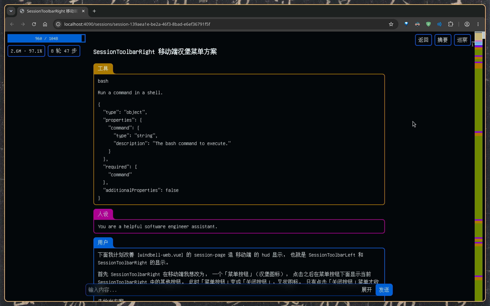
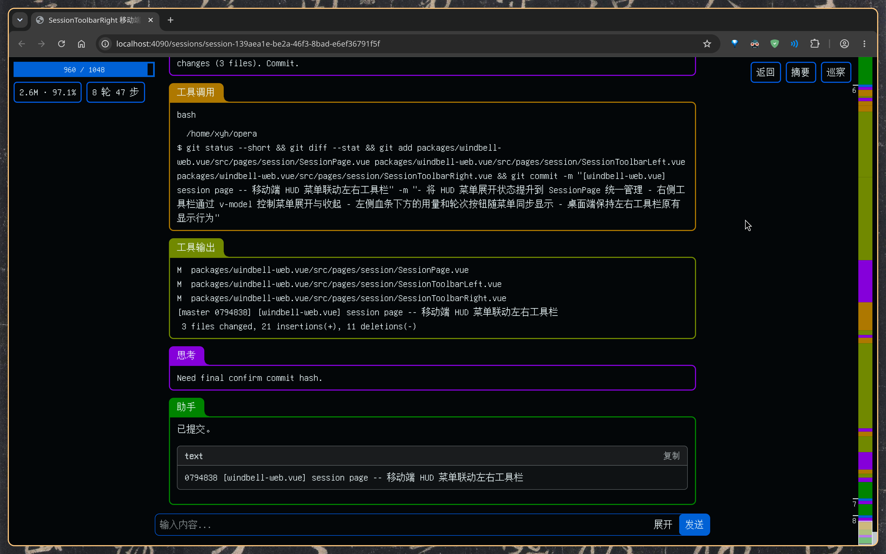
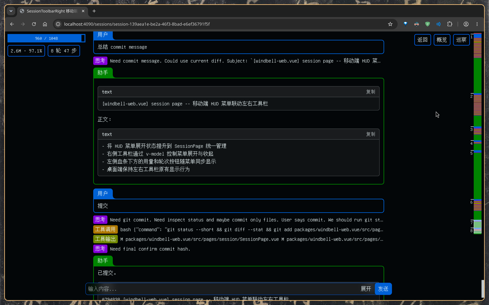
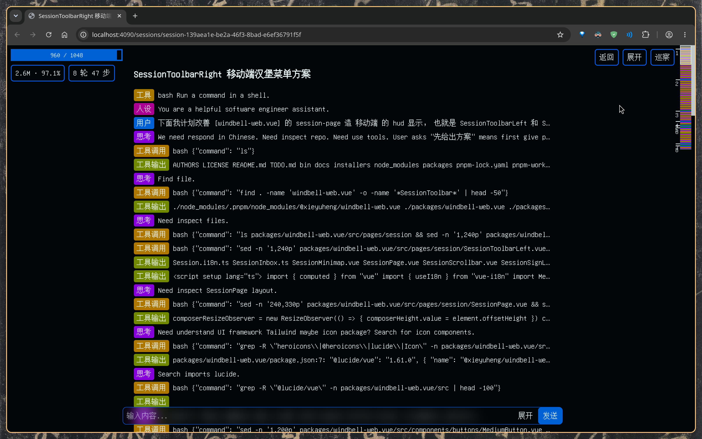
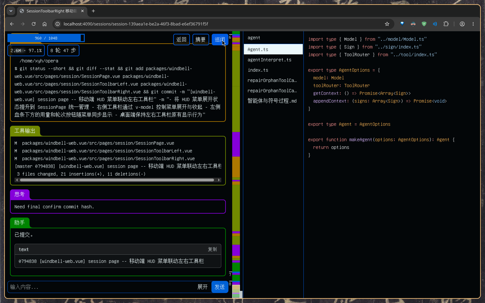
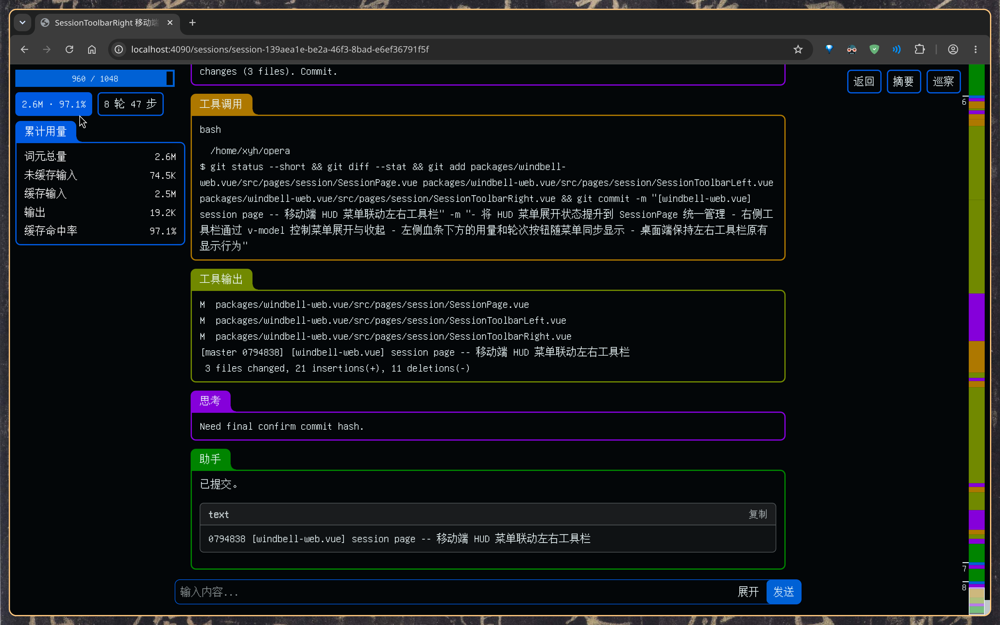
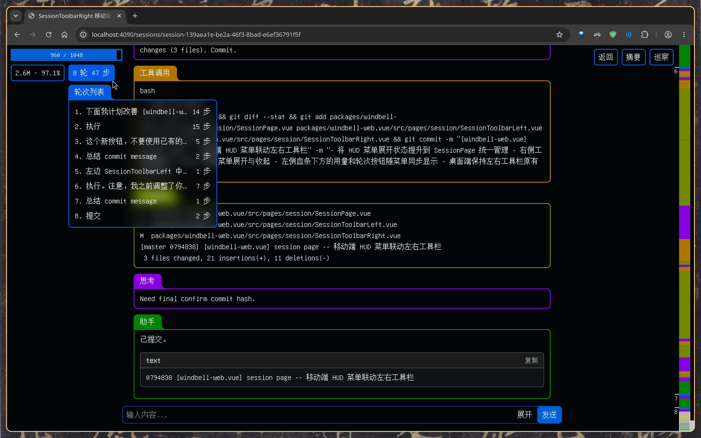

> * 思维不是一个封闭的内在过程，而是一个符号解释的过程，\
>   每一个思想都是一个符号，它指向另一个符号，\
>   如此无限延伸。
> * 人的思想就是符号的连续解释过程。
> * 人即符号。
>
> -- 皮尔士

## 弯子

下面我将用最直白，最不绕弯子的方式，向你介绍「风铃」编程智能体是什么。

其实就是用一堆我自己日常使用过程中的截图，来介绍「风铃」的功能。

这种介绍方式最真实。

## 对话

首先最日常的就是「对话页面」（Session Page）。

下面两个截图是一个完成了的对话页面。

对话开始部分：

- 「工具」是智能体所能使用的工具。在 Linux 上只有 `bash`。
- 「人设」告诉智能体应该扮演什么角色，是所谓「系统提示词」。
- 「用户」是我发出的信息，描述了我想要完成的编程任务。

{data-zoomable}

对话结束部分：

- 「工具调用」是智能体想要在机器上调用 `bash` 来运行的命令。
- 「工具输出」是 `bash` 命令的输出。
- 「思考」智能体的思考过程。
- 「助手」任务完成之后，智能体对我的答复。

{data-zoomable}

### 血条

对话页面的左上角是智能体的「血条」。

- 代表当前可以使用的「剩余上下文空间」。
- 一点血代表 1K 词元。
- 这里的 DeepSeek 有 1000 多点血上限，就是 1M 词元的上下文上限。
- 上下文用尽的时候，这场对话就 "game over" 了。

### 小地图

对话页面最右边的彩色一条是「小地图」。

- 对应对话页面中符号的颜色与位置。
- 鼠标在小地图上滑动，可以快速定位到某个符号卡片。

### 展开、摘要、概览

对话页面有三种模式。

上面两张截图是默认的「展开」模式，
所有「符号」（Sign）卡片都展开。

点击右上工具栏中的「摘要」按钮，
可以进入「摘要」模式：

- 除了「用户」和「助手」这两种符号展开，其他符号卡片都收起来成一行。

{data-zoomable}

在「摘要」状态下，点击右上工具栏中的「概览」按钮，
可以进入「概览」模式：

- 所有符号卡片都收起。

{data-zoomable}

### 巡察

点击右上工具栏中的「巡察」按钮，可以打开文件查看器。

点击「巡闭」按钮，可以关闭。

{data-zoomable}

### 统计

左上工具栏中，有两个统计信息类的按钮。

「累积用量」：

- 每一步与语言大模型对话，都需要把所有上下文发送给大模型。
- 而上下文本身就是在不断累积的，
  所以这里的「累积用量」是一个递增数列的加和。
- 类似于 1 + 2 + 3 + 4 + 5 + ... + n，
  其数值最终可能远远大于 n 这个「血上限」。

{data-zoomable}

「轮次列表」：

- 一个「轮次」（Turn）是一轮由「用户」输入信息发起的「工具调用」循环。
- 列表中的「轮次」是可以点击的，点击可以跳到对应的符号卡片。

{data-zoomable}
